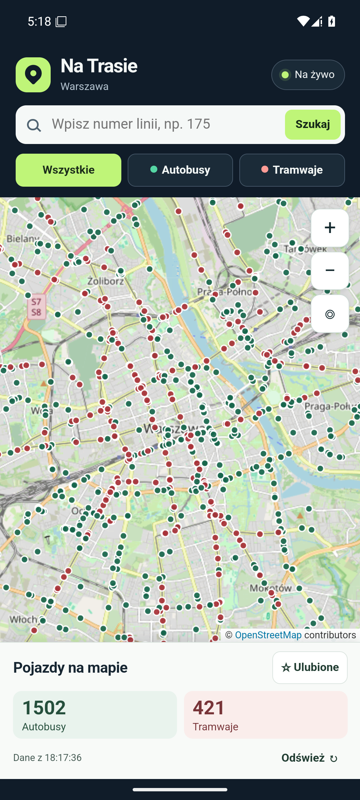

# Na Trasie

Aplikacja na Androida z mapą pozycji GPS warszawskich autobusów i tramwajów. Możesz filtrować pojazdy według typu, wyszukać konkretną linię i zapisać ją w ulubionych. Po dotknięciu pojazdu zobaczysz dostępny numer taborowy, brygadę i czas ostatniej pozycji. Dane odświeżają się co 30 sekund, gdy aplikacja jest na ekranie.



## Instalacja

Pobierz `NaTrasie.apk` z [wydań na GitHubie](https://github.com/kripusek/NaTrasie/releases), przenieś go na telefon z Androidem 8 lub nowszym i otwórz plik. Jeśli Android poprosi o zgodę na instalację z tego źródła, udziel jej aplikacji, w której otwierasz APK. Mapa i pozycje GPS wymagają internetu.

Możesz też zainstalować APK przez ADB po włączeniu debugowania USB.

```sh
adb install -r NaTrasie.apk
```

## Budowanie

Potrzebne są Node.js, JDK 17 lub nowszy i Android SDK z platformą 36 oraz Build Tools 35.0.0. Ustaw `ANDROID_HOME` lub wskaż SDK w `local.properties`.

```powershell
npm.cmd ci
.\gradlew.bat assembleDebug
```

Na macOS i Linuksie użyj `npm ci` i `./gradlew assembleDebug`. APK pojawi się w `app/build/outputs/apk/debug/app-debug.apk`.

Podgląd w przeglądarce uruchomisz poleceniem `npm run preview` (w PowerShellu `npm.cmd run preview`). Otwórz wtedy `http://127.0.0.1:4173`.

## Źródła danych

Pozycje udostępnia [Miasto Stołeczne Warszawa](https://api.um.warszawa.pl/). Źródło GTFS-RT to [mkuran.pl](https://mkuran.pl/gtfs/), a mapę dostarcza [OpenStreetMap](https://www.openstreetmap.org/copyright).
